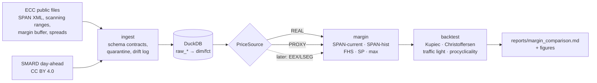

# power-margin-lab

> **Status: v1 – historical analysis uses a SMARD proxy; real EEX futures history pending.**

A reproducible comparison of two initial-margin models for portfolios of German baseload
power futures (month, quarter, year):

- a **simplified SPAN** following ECC's published methodology, and
- a **Prisma-inspired FHS model** (filtered historical simulation), with backtesting,
  procyclicality analysis and a documented data model.

[Deutsche Version](README.md)

## What and why

European Commodity Clearing (ECC) is replacing SPAN with **ECC Prisma for Commodities**, a
portfolio-based model with:

- FHS VaR at 99 % and a 2-day MPOR,
- a 3-year window,
- a stress-period component: market-risk IM = max(FHS, SP),
- liquidity and concentration adjustments.

The parallel run started on 19 Oct 2026, and the migration is planned for March 2027
([Prisma migration](https://www.ecc.de/en/access/connectivity-and-reports/prisma-migration),
[webinar June 2026](https://www.ecc.de/fileadmin/ECC/Access/Prisma_Migration/Webinar_ECC_Prisma_for_Commodities_June_2026.pdf),
[press release 9 Jan 2026](https://www.ecc.de/fileadmin/Global/News/ECC/ECC_Press_Release/2026/20260109_R7Prisma_final.pdf)).
This project asks the question members face during the parallel run: *how does IM change for
typical power portfolios, and how do both models behave in backtests and stress?*

**Not an ECC product.** This does not replicate ECC Prisma. ECC's Prisma calibration is
member-only, so all FHS parameters here are assumptions ([docs/DECISIONS.md](docs/DECISIONS.md)).
Background: [docs/background.md](docs/background.md).

## Architecture



## Quickstart (5 commands)

Requires [uv](https://docs.astral.sh/uv/). There is **no manual export step**: Energy-Charts
may not be exported, so data comes from ECC's public files and SMARD.

```sh
git clone https://github.com/kaiffarooqui970/power-margin-lab && cd power-margin-lab
make setup        # Python 3.11 + dependencies
make all          # download (ECC ~20 MB/day + 55 MB spreads, SMARD) -> ingest -> build -> margin -> backtest -> report
open reports/margin_comparison.md
make test         # unit tests + end-to-end smoke test on synthetic data
```

### Daily download (ECC publishes only about one month)

```sh
sh scripts/install_launchd.sh                                        # macOS LaunchAgent, Mon-Fri 22:15
launchctl kickstart -k gui/$(id -u)/de.powermarginlab.ecc-download   # run once now
tail data/logs/ecc_download.log
sh scripts/install_launchd.sh --remove
```

The job runs `ecc_files --date all --with-spanfile`. It is idempotent and catches up on missed
days that are still on ECC's server. The ~55 MB spreads file is fetched only with
`--with-spreads`; `make download` gets it for the latest day. A cron alternative is in the
German README. Downloaded files are local only. They are never committed, and there is no
GitHub Actions job that stores them.

## Methodology (summary)

Full text: [docs/METHODOLOGY.md](docs/METHODOLOGY.md).

- **Data.** `REAL` is ECC SPAN-file settlement prices and ECC parameters, used for "today" and
  for validation. `PROXY` is a synthetic tenor series from SMARD day-ahead prices (30-day mean,
  scaled per tenor by ECC's relative scanning ranges), used for history. Every number records
  its source.
- **SPAN-current.** ECC's real scanning ranges and spread credits. German power has no
  intra-commodity charge (single-expiry tiers); calendar spreads get inter-tier credits.
- **SPAN-hist.** ECC's published scanning-range formula (EWMA λ 0.99, 255 returns, risk
  multiplier 2.66-3.5, APC buffer up to 25 %) on the proxy. It is validated against the real
  ranges, not calibrated to them.
- **Prisma-inspired FHS.** EWMA λ 0.94 (sensitivity 0.97), volatility floor, 3-year window,
  overlapping 2-day joint scenarios, VaR 99 % and ES 97.5 %. Unfiltered stress period Sep
  2021 - Mar 2023; market-risk IM = max(FHS, SP).

## Key results

<!-- RESULTS:START -->
*Generated from `reports/` (as of 2026-10-16). Source of each number in brackets.*

- Today: max(FHS, SP) vs. SPAN-current: -28 % to +12 % per portfolio; the stress-period component binds in 5/5 (REAL prices, PROXY scenarios).
- Backtest 2021-11-01 to 2026-10-14: plain FHS 12, max(FHS, SP) 3-4 breaches vs. 12.7 expected. The SP floor is conservative by design: IM on average +37 to +39 % above FHS, in exchange for less variation (PROXY).
- SPAN-hist vs. real ECC scanning ranges (M1, 22 days): mean error -24.8 %, caused by the smoothing in the proxy (PROXY vs. REAL).
- Y1/Y2 correlation is 0.92 in REAL data (95 %: 0.82-0.97) vs. 1 in the proxy: with the real correlation the calendar-spread IM would be 1.09x as high (parametric, REAL).

Details: [reports/margin_comparison.md](reports/margin_comparison.md)
<!-- RESULTS:END -->

## Validation

- **Backtest.** Kupiec POF, Christoffersen independence (also on non-overlapping days) and the
  Basel traffic light per 250 observations.
- **Procyclicality.** Peak/trough, maximum 5- and 30-day increase, and IM around August 2022.
- **Diversification ratios.**
- **SPAN-hist vs. real ECC ranges,** plus a formula check with real volatility.
- **Correlation check of the single-factor proxy.**
- **Data quality.** Schema contracts, quarantine and drift log; all tests run in CI on
  synthetic data.

## Data model

See [docs/DATA_MODEL.md](docs/DATA_MODEL.md) for the Mermaid ERD, the grain of each table and
the lineage from raw to results. Glossary DE/EN: [docs/GLOSSARY.md](docs/GLOSSARY.md).

## Plugging in real EEX history

1. Put EEX/LSEG settlement exports in `data/raw/eex/` (never commit them).
2. Implement `EexHistorySource.settlements()` in `src/power_margin_lab/sources/eex.py`,
   returning `trade_date`, `product_id` (`DEBM-2026-11`, `DEBQ-2027-Q1`, `DEBY-2027`) and
   `price` in EUR/MWh. Add a schema contract.
3. Set `history.source: eex` in `config/model.yml` and select the source in `stages/build.py`.

The models and backtests then run unchanged, and the results are labelled `REAL`.

## Known limitations

Full list: [docs/LIMITATIONS.md](docs/LIMITATIONS.md).

- **Scope.** Baseload only.
- **History.** It is a **single-factor spot proxy**: tenor correlation 1, lower volatility than
  futures, autocorrelated returns.
- **REAL data.** Real history is only about one month, and ECC files are a secondary source of
  EEX prices.
- **Simplified models.** SPAN-hist is a proxy. SPAN and FHS are simplified: no liquidity,
  concentration or delivery risk as ECC models them.
- **Not affiliated with ECC.**

## Citation / contact

Kaif Ahmed Farooqui, GitHub [kaiffarooqui970](https://github.com/kaiffarooqui970).
Suggested citation: *Farooqui, K. A. (2026). power-margin-lab: simplified SPAN vs.
Prisma-inspired FHS initial margin for German power futures.*
<https://github.com/kaiffarooqui970/power-margin-lab>

Personal project; not affiliated with ECC, EEX or Deutsche Börse.

## Licence and data notice

- **Code.** MIT ([LICENSE](LICENSE)).
- **No raw data in this repository.** `data/` is gitignored; only code, synthetic fixtures,
  download instructions and **derived results** (`reports/`) are committed.
- **ECC/EEX files.** From
  <https://public.eex-group.com/ecc/risk-management/reports-files/index.html>; systematic
  republication requires EEX/ECC permission. The files are used locally only.
- **SMARD.** Bundesnetzagentur | SMARD.de, licensed
  [CC BY 4.0](https://creativecommons.org/licenses/by/4.0/).
- **Trademarks and affiliation.** SPAN® is a registered trademark of Chicago Mercantile
  Exchange Inc. ECC Prisma for Commodities is a product of European Commodity Clearing AG. This
  project is not affiliated with ECC, EEX or Deutsche Börse.
