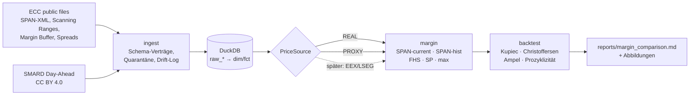

# power-margin-lab

> **Status: v1 – die historische Analyse nutzt einen SMARD-Proxy; echte EEX-Futures-Historie steht noch aus.**

Reproduzierbarer Vergleich zweier Initial-Margin-Modelle für Portfolios aus deutschen
Grundlast-Strom-Futures (Monat, Quartal, Jahr):

- ein **vereinfachtes SPAN** nach der veröffentlichten ECC-Methodik und
- ein **Prisma-inspiriertes FHS-Modell** (Filtered Historical Simulation), mit Rückvergleich,
  Prozyklizitätsanalyse und sauberem Datenmodell.

[English version](README.en.md)

## Was und warum

Die European Commodity Clearing (ECC) ersetzt ihr SPAN-Modell durch **ECC Prisma for
Commodities**. Das ist ein portfoliobasiertes Modell mit:

- FHS-VaR bei 99 % und 2 Tagen Haltedauer,
- einem 3-Jahres-Fenster,
- einer Stressperioden-Komponente: Marktrisiko-IM = max(FHS, SP),
- sowie Liquiditäts- und Konzentrationsaufschlägen.

Der Parallelbetrieb läuft seit dem 19.10.2026, die Migration ist für März 2027 geplant
([Prisma-Migration](https://www.ecc.de/en/access/connectivity-and-reports/prisma-migration),
[Webinar Juni 2026](https://www.ecc.de/fileadmin/ECC/Access/Prisma_Migration/Webinar_ECC_Prisma_for_Commodities_June_2026.pdf),
[Pressemitteilung 09.01.2026](https://www.ecc.de/fileadmin/Global/News/ECC/ECC_Press_Release/2026/20260109_R7Prisma_final.pdf)).
Dieses Projekt stellt die Frage, die Clearingmitglieder im Parallelbetrieb haben: *Wie
verändert sich die IM für typische Strom-Portfolios, und wie verhalten sich beide Modelle im
Rückvergleich und in Stressphasen?*

**Kein ECC-Produkt.** Das Modell repliziert ECC Prisma nicht. ECCs Prisma-Kalibrierung ist
nur für Mitglieder zugänglich; alle FHS-Parameter hier sind Annahmen
([docs/DECISIONS.md](docs/DECISIONS.md)). Hintergrund: [docs/background.md](docs/background.md).

## Architektur



Code: `src/power_margin_lab/`:

- `ingest/`: Downloads und Parser
- `contracts/`: YAML-Schemaverträge
- `model/`: Produkte, Tenore, Portfolios
- `sources/`: PriceSource-Implementierungen
- `margin/`: SPAN, FHS, Stress
- `validation/`: Backtest, Prozyklizität
- `report/`: Report-Erzeugung
- `stages/`: Pipeline-Schritte

Parameter liegen in `config/model.yml`, die Portfolios in `config/portfolios.yml`.

## Schnellstart (5 Befehle)

Voraussetzung: [uv](https://docs.astral.sh/uv/). Es gibt **keinen manuellen Export-Schritt
mehr**: Energy-Charts darf nicht exportiert werden, die Daten kommen aus ECCs öffentlichen
Dateien und von SMARD.

```sh
git clone https://github.com/<user>/power-margin-lab && cd power-margin-lab
make setup        # Python 3.11 + Abhängigkeiten
make all          # Download (ECC ~20 MB/Tag + 55 MB Spreads, SMARD) -> ingest -> build -> margin -> backtest -> report
open reports/margin_comparison.md
make test         # Unit-Tests + End-to-End-Smoke-Test auf synthetischen Daten
```

### Täglicher Download (ECC veröffentlicht nur ~1 Monat)

ECC hält nur etwa einen Monat an Dateien vor. Um eine echte Historie aufzubauen, sollte der
Download täglich lokal laufen. Die Dateien werden **nie** committet, und es gibt keinen
GitHub-Actions-Job, der sie speichert.

```sh
sh scripts/install_launchd.sh                              # macOS LaunchAgent, Mo-Fr 22:15
launchctl kickstart -k gui/$(id -u)/de.powermarginlab.ecc-download   # einmal sofort testen
tail data/logs/ecc_download.log
sh scripts/install_launchd.sh --remove                     # wieder entfernen
```

Der Job ruft `ecc_files --date all --with-spanfile` auf. Er ist idempotent und holt
verpasste Tage nach, solange sie noch bei ECC liegen; launchd startet verpasste Läufe nach dem
Aufwachen des Macs. Die Spreads-Datei (~55 MB) wird nur mit `--with-spreads` geladen; `make
download` holt sie für den jeweils letzten Tag.

Alternative mit cron (`crontab -e`):

```
15 22 * * 1-5 cd $HOME/power-margin-lab && $HOME/.local/bin/uv run python -m power_margin_lab.ingest.ecc_files --date all --with-spanfile >> data/logs/ecc_download.log 2>&1
```

## Methodik (Kurzfassung)

Details: [docs/METHODOLOGY.md](docs/METHODOLOGY.md).

- **Daten.** `REAL` sind ECC-SPAN-Datei-Abrechnungspreise und ECC-Parameter; sie werden für den
  heutigen Vergleich und für Validierungen genutzt. `PROXY` ist eine synthetische Tenor-Serie
  aus SMARD-Day-Ahead-Preisen (30-Tage-Mittel, je Tenor skaliert mit ECCs relativen Scanning
  Ranges); sie liefert die Historie. Jede Zahl trägt ihre Quelle.
- **SPAN-current.** Echte ECC-Scanning-Ranges und -Spread-Gutschriften. Für deutsche
  Strom-Futures gibt es keinen Intra-Commodity-Aufschlag (Single-Expiry-Tiers);
  Kalenderspreads werden über Inter-Tier-Gutschriften entlastet.
- **SPAN-hist.** ECCs veröffentlichte Scanning-Range-Formel (EWMA λ 0,99, 255 Renditen,
  Risikomultiplikator 2,66-3,5, APC-Puffer bis 25 %) auf der Proxy-Historie. Sie wird gegen die
  echten Ranges validiert und nicht kalibriert.
- **Prisma-inspiriertes FHS.** EWMA λ 0,94 (Sensitivität 0,97), Volatilitätsuntergrenze,
  3-Jahres-Fenster, überlappende 2-Tages-Szenarien gemeinsam über alle Tenore, VaR 99 % und
  ES 97,5 %. Stressperiode Sep 2021 - Mär 2023, ungefiltert; Marktrisiko-IM = max(FHS, SP).

## Wichtigste Ergebnisse

<!-- RESULTS:START -->
*Automatisch erzeugt aus `reports/` (Stand 2026-10-16). Quelle je Zahl in Klammern.*

- Heute: max(FHS, SP) vs. SPAN-current: -28 % bis +12 % je Portfolio; SP bindet in 5/5 (REAL-Preise, PROXY-Szenarien).
- SPAN-hist vs. echte ECC-Scanning-Ranges (M1, 22 Tage): mittlerer Fehler -24.8 %, max. 27.4 % (PROXY vs. REAL).
- Backtest 2021-11-01 bis 2026-10-14: FHS 12, max(FHS, SP) 3-4 Überschreitungen bei 12.7 erwarteten (PROXY).
- Korrelation Y1/Y2 real 0.92 statt 1 im Proxy: mit realer Korrelation wäre die IM des Kalenderspreads 1.09x so hoch (parametrisch, REAL).

Details: [reports/margin_comparison.md](reports/margin_comparison.md)
<!-- RESULTS:END -->

## Validierung

- **Backtest.** Kupiec POF, Christoffersen-Unabhängigkeit (auch auf nicht überlappenden
  Tagen) und Basler Ampel je 250 Beobachtungen.
- **Prozyklizität.** Verhältnis Höchst- zu Tiefstwert, maximale 5-/30-Tages-Anstiege und die
  IM um August 2022.
- **Diversifikation.** IM(Portfolio) / Σ IM(Einzelpositionen).
- **SPAN-hist gegen echte ECC-Ranges.** Ergänzt um eine Formelprüfung mit realer Volatilität.
- **Korrelationsprüfung des Ein-Faktor-Proxys.**
- **Datenqualität.** Schemaverträge, Quarantäne und Drift-Log; alle Tests laufen in
  CI auf synthetischen Daten.

## Datenmodell

Siehe [docs/DATA_MODEL.md](docs/DATA_MODEL.md): Mermaid-ERD, Granularität jeder Tabelle und
Lineage von `raw_*` bis zu den Ergebnis-Tabellen. Kern: `dim_product` (Lieferstunden in UTC,
inkl. Zeitumstellung), `fct_settlement`, `fct_tenor_series` (Rendite immer im selben
Kontrakt), `fct_position`, `fct_span_parameter`, `fct_margin_result`, `fct_backtest_result`.
Begriffe: [docs/GLOSSARY.md](docs/GLOSSARY.md).

## Echte EEX-Historie anschließen

Sobald EEX/LSEG-Abrechnungspreise vorliegen:

1. Die Exporte nach `data/raw/eex/` legen (nicht committen).
2. `EexHistorySource.settlements()` in `src/power_margin_lab/sources/eex.py` implementieren:
   Spalten `trade_date`, `product_id` (z. B. `DEBM-2026-11`, `DEBQ-2027-Q1`, `DEBY-2027`) und
   `price` (EUR/MWh). Dazu einen Schemavertrag in `contracts/schemas/` anlegen.
3. In `config/model.yml` `history.source: eex` setzen und in `stages/build.py` die Quelle
   auswählen.

Tenor-Mapping, No-Roll-Renditen, FHS, SPAN-hist und Backtest laufen unverändert; die
Ergebnisse tragen dann `REAL`.

## Bekannte Einschränkungen

Vollständig in [docs/LIMITATIONS.md](docs/LIMITATIONS.md):

- **Umfang.** Nur Grundlast; keine Peak-, Wochen- oder Wochenendkontrakte; keine Optionen.
- **Historie.** Sie ist ein **Ein-Faktor-Spot-Proxy**: Korrelation 1 zwischen Tenoren,
  niedrigere Volatilität als Futures, autokorrelierte Renditen.
- **REAL-Daten.** Echte Historie nur etwa 1 Monat; ECC-Daten sind Sekundärquelle der
  EEX-Preise.
- **Vereinfachte Modelle.** SPAN-hist ist ein Proxy. SPAN und FHS sind vereinfacht: keine
  Liquiditäts-, Konzentrations- oder Lieferrisiken wie bei ECC.
- **Keine Verbindung zu ECC.**

## Lizenz und Datenhinweis

- **Code.** MIT-Lizenz ([LICENSE](LICENSE)).
- **Keine Rohdaten im Repository.** `data/` ist vollständig in `.gitignore`. Im Repository
  liegen nur Code, synthetische Test-Fixtures, Download-Anleitungen und **abgeleitete
  Ergebnisse** (`reports/`).
- **ECC/EEX-Daten.** Öffentliche ECC-Dateien von
  <https://public.eex-group.com/ecc/risk-management/reports-files/index.html>; die
  systematische Weiterveröffentlichung erfordert die Zustimmung von EEX/ECC. Die Daten werden
  nur lokal genutzt.
- **SMARD.** Day-Ahead-Preise: Bundesnetzagentur | SMARD.de, Lizenz
  [CC BY 4.0](https://creativecommons.org/licenses/by/4.0/).
- **SPAN®** ist eine eingetragene Marke der Chicago Mercantile Exchange Inc. *ECC Prisma for
  Commodities* ist ein Produkt der European Commodity Clearing AG. Dieses Projekt ist nicht mit
  ECC, EEX oder der Deutschen Börse verbunden.
