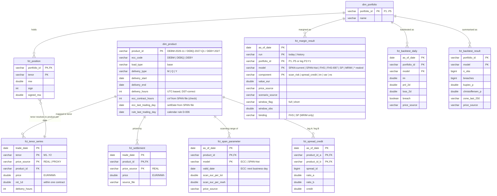
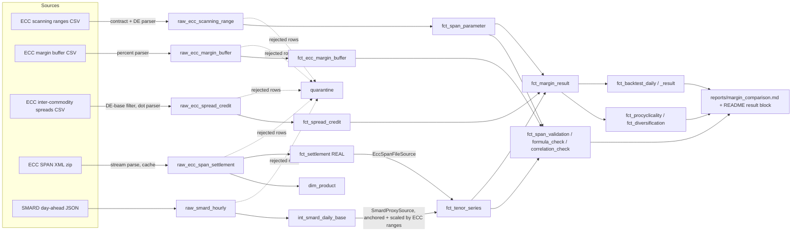

# Data model

Local DuckDB warehouse `data/warehouse.duckdb` (gitignored). The layers are:

- **raw_\***: validated copies of source files.
- **int_\***: intermediate aggregates.
- **dim_\* / fct_\***: the domain model.
- **meta_\* / dq_\* / quarantine**: run metadata and data quality.

Every fact that carries prices or results has a `price_source` column (`REAL` | `PROXY`).

## ERD (domain model)

`fct_position` references tenors, not products. The product is resolved per date through
`fct_tenor_series`, which is the mapping table, so a position "long Y1" always points to the
contract that is Y1 on that date.

## Grain and keys

| Table | Grain (one row per …) | Key |
|---|---|---|
| raw_ecc_scanning_range | ECC file × product code × expiry | calc_date, product_code, expiry_year, expiry_month |
| raw_ecc_margin_buffer | ECC file × product × relative maturity | calc_date, product_maturity |
| raw_ecc_spread_credit | spreads file × tier pair (German base subset) | calc_date, spread_id |
| raw_ecc_span_settlement | SPAN file × German base futures contract | calc_date, pf_code, period |
| raw_smard_hourly | delivery hour (UTC ms) | ts_ms |
| int_smard_daily_base | Berlin delivery day | delivery_day |
| dim_product | contract (delivery period) | product_id |
| fct_settlement | trade date × contract × source | trade_date, product_id, price_source |
| fct_tenor_series | trade date × tenor × source | trade_date, tenor, price_source |
| dim_portfolio | portfolio | portfolio_id |
| fct_position | portfolio × tenor | portfolio_id, tenor |
| fct_span_parameter | as-of date × contract × model | as_of_date, product_id, model |
| fct_span_hist_detail | trade date × tenor (σ, R, b, SMP) | trade_date, tenor |
| fct_spread_credit | as-of date × contract pair | as_of_date, product_id_a, product_id_b |
| fct_ecc_margin_buffer | as-of date × ECC code × relative maturity | as_of_date, ecc_code, relative_maturity |
| fct_margin_result | date × run × book × model × component | as_of_date, run, portfolio_id, model, component |
| fct_backtest_daily | date × book × model | as_of_date, portfolio_id, model |
| fct_backtest_result | book × model | portfolio_id, model |
| fct_procyclicality | portfolio × model | portfolio_id, model |
| fct_diversification | portfolio × run × model | portfolio_id, run, model |
| fct_span_validation(_daily) | tenor (× trade date) | tenor (, trade_date) |
| fct_span_formula_check | tenor, as-of date | tenor |
| fct_correlation_check | spread portfolio | portfolio_id |
| quarantine | rejected source row | (contract, source_file, raw_record) |
| meta_schema_drift | drift event | (contract, source_file) |

"Book" means a portfolio or one of its single legs (`P3:Y1`), which are needed for
diversification ratios.

## Lineage

Stages: `ingest` (raw_\*, quarantine, drift) → `build` (dim/fct up to fct_tenor_series) →
`margin` → `backtest` → `report`.
