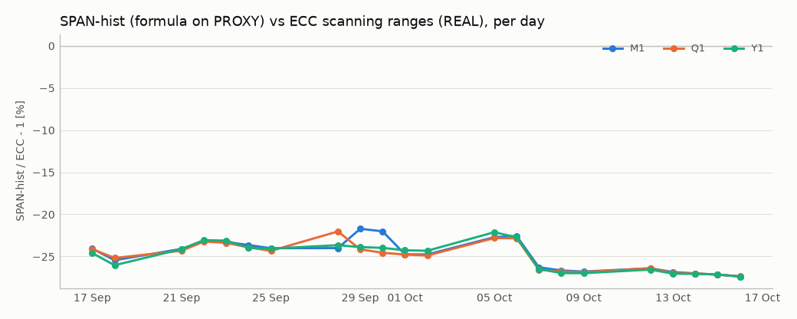
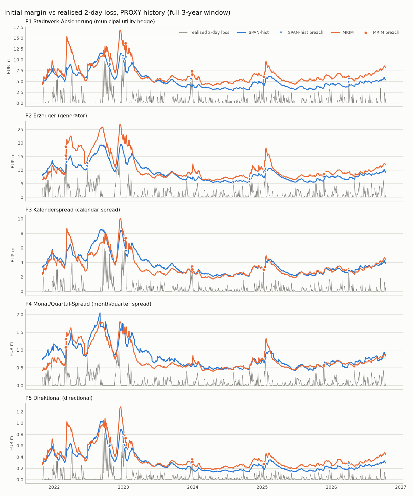
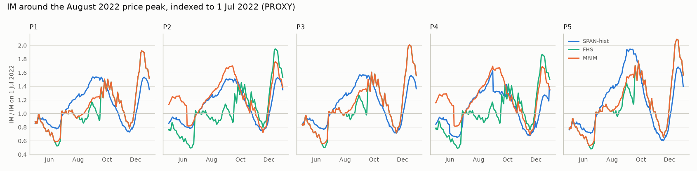

# Margin comparison: simplified SPAN vs. Prisma-inspired FHS

> **v1: historical analysis uses a SMARD proxy; real EEX futures history pending.**

Generated by `make report` on 2026-10-18 from the local warehouse. As-of date (latest REAL ECC file): **2026-10-16**. REAL history collected: 22 business days from 2026-09-17. PROXY history: 2018-10-30 to 2026-10-16.

**Price sources.** `REAL` = settlement prices and SPAN parameters from ECC's public daily files (data: EEX via ECC). `PROXY` = synthetic tenor series from SMARD day-ahead prices (Bundesnetzagentur | SMARD.de, CC BY 4.0), single factor, per-tenor scaling M1=1.000, M2=0.862, M3=0.844, Q1=0.829, Q2=0.762, Y1=0.671, Y2=0.335. This is a Prisma-*inspired* model, not ECC Prisma; ECC's Prisma calibration is member-only and every parameter here is an assumption (docs/DECISIONS.md).

Data quality: 24 rows quarantined (price: not above 0.01: 24); 0 schema-drift events.

## 1. Today: IM per portfolio (REAL prices)

MRIM = market-risk initial margin = max(FHS, SP). All values EUR million.

SPAN-current uses ECC's scanning ranges and inter-commodity credits of 2026-10-16 (credit file 2026-10-16). SPAN-hist applies ECC's published scanning-range formula to the PROXY history (validated in section 2). FHS and SP value today's REAL positions under PROXY historical scenarios. *Real-vol* variant: FHS rescaled to the current volatility of the REAL futures returns (EWMA, lambda 0.94, over the collected REAL days) instead of the proxy's.

| Portfolio | SPAN-current [EUR m] | SPAN-hist [EUR m] | FHS 99 % [EUR m] | SP [EUR m] | MRIM = max(FHS, SP) [EUR m] | binding | MRIM vs SPAN-current | MRIM real-vol [EUR m] | binding (real-vol) | real-vol vs SPAN-current |
|---|---|---|---|---|---|---|---|---|---|---|
| P1 Stadtwerk-Absicherung (municipal utility hedge) | 7.30 | 5.30 | 4.91 | 8.21 | 8.21 | SP | +12.4 % | 8.21 | SP | +12.4 % |
| P2 Erzeuger (generator) | 12.63 | 9.17 | 7.34 | 12.03 | 12.03 | SP | -4.8 % | 12.03 | SP | -4.8 % |
| P3 Kalenderspread (calendar spread) | 5.24 | 3.80 | 2.66 | 4.43 | 4.43 | SP | -15.5 % | 4.43 | SP | -15.5 % |
| P4 Monat/Quartal-Spread (month/quarter spread) | 1.15 | 0.84 | 0.51 | 0.83 | 0.83 | SP | -27.8 % | 0.88 | FHS | -23.7 % |
| P5 Direktional (directional) | 0.40 | 0.29 | 0.27 | 0.45 | 0.45 | SP | +10.9 % | 0.45 | SP | +10.9 % |

Source: REAL prices and ECC parameters; FHS/SP scenarios PROXY.

## 2. Validation of SPAN-hist against real ECC scanning ranges

Same formula, parameters taken from ECC's risk parameter file, no tuning. Error = SPAN-hist (formula on PROXY returns x REAL price) / ECC - 1, per REAL day.

| Tenor | days | mean error | mean abs error | max abs error | source |
|---|---|---|---|---|---|
| M1 | 22 | -24.8 % | 24.8 % | 27.4 % | SPAN-hist on PROXY vs ECC (REAL) |
| M2 | 22 | -26.0 % | 26.0 % | 35.0 % | SPAN-hist on PROXY vs ECC (REAL) |
| M3 | 22 | -25.5 % | 25.5 % | 27.4 % | SPAN-hist on PROXY vs ECC (REAL) |
| Q1 | 22 | -25.0 % | 25.0 % | 27.3 % | SPAN-hist on PROXY vs ECC (REAL) |
| Q2 | 22 | -26.5 % | 26.5 % | 30.1 % | SPAN-hist on PROXY vs ECC (REAL) |
| Y1 | 22 | -25.0 % | 25.0 % | 27.4 % | SPAN-hist on PROXY vs ECC (REAL) |
| Y2 | 22 | -24.2 % | 24.2 % | 27.3 % | SPAN-hist on PROXY vs ECC (REAL) |

Because the proxy is one factor scaled by s_k (taken from ECC's ranges), all tenors share M1's relative error up to the day-to-day change of ECC's ratios: **only the M1 row is an independent check**.

Formula check on the as-of date: volatility from the REAL returns collected so far (too few for ECC's 255-return window and for R, so R is backed out instead).

| Tenor | REAL returns | sigma REAL (daily) | sigma PROXY (daily) | ECC buffer | SPAN-hist buffer | SPAN-hist R | implied R (REAL sigma, ECC buffer) | inside [R_min, R_max] |
|---|---|---|---|---|---|---|---|---|
| M1 | 21 | 3.06 % | 2.17 % | 23.9 % | 25.0 % | 2.78 | 2.74 | yes |
| M2 | 21 | 2.70 % | 1.87 % | 22.9 % | 25.0 % | 2.78 | 2.70 | yes |
| M3 | 21 | 2.55 % | 1.83 % | 23.3 % | 25.0 % | 2.78 | 2.79 | yes |
| Q1 | 21 | 2.68 % | 1.80 % | 23.3 % | 25.0 % | 2.78 | 2.61 | no |
| Q2 | 21 | 2.08 % | 1.65 % | 22.8 % | 25.0 % | 2.78 | 3.10 | yes |
| Y1 | 21 | 1.74 % | 1.46 % | 23.4 % | 25.0 % | 2.78 | 3.24 | yes |
| Y2 | 21 | 1.09 % | 0.73 % | 25.0 % | 25.0 % | 2.78 | 2.55 | no |

## 3. IM time series and breaches (PROXY)

Table view: `fct_backtest_daily` in the warehouse (one row per day, portfolio, model).

## 4. Backtest summary (PROXY, 99 %, 2-day)

Breach: realised 2-day loss > IM. Overlapping 2-day windows make breaches dependent by construction, so the Christoffersen test is also shown on the non-overlapping subsample (every second day). Single-factor proxy: books with the same sign of net factor exposure breach on the same days.

| Model | Portfolio | n | breaches | expected | Kupiec p | Christoffersen p | Kupiec p (non-overl.) | Christoffersen p (non-overl.) | last 250: breaches / zone | worst 250: breaches / zone | source |
|---|---|---|---|---|---|---|---|---|---|---|---|
| SPAN-hist | P1 | 1266 | 14 | 12.7 | 0.710 | <0.001 | 0.792 | 0.060 | 2 / green | 7 / yellow | PROXY |
| SPAN-hist | P2 | 1266 | 13 | 12.7 | 0.924 | <0.001 | 0.792 | 0.692 | 2 / green | 6 / yellow | PROXY |
| SPAN-hist | P3 | 1266 | 6 | 12.7 | 0.036 | <0.001 | 0.138 | 0.866 | 1 / green | 4 / green | PROXY |
| SPAN-hist | P4 | 1266 | 4 | 12.7 | 0.004 | 0.007 | 0.043 | 0.910 | 1 / green | 2 / green | PROXY |
| SPAN-hist | P5 | 1266 | 14 | 12.7 | 0.710 | <0.001 | 0.792 | 0.060 | 2 / green | 7 / yellow | PROXY |
| FHS | P1 | 1266 | 12 | 12.7 | 0.851 | <0.001 | 0.581 | 0.026 | 2 / green | 6 / yellow | PROXY |
| FHS | P2 | 1266 | 12 | 12.7 | 0.851 | <0.001 | 0.581 | 0.778 | 1 / green | 7 / yellow | PROXY |
| FHS | P3 | 1266 | 12 | 12.7 | 0.851 | <0.001 | 0.581 | 0.026 | 2 / green | 6 / yellow | PROXY |
| FHS | P4 | 1266 | 12 | 12.7 | 0.851 | <0.001 | 0.581 | 0.778 | 1 / green | 7 / yellow | PROXY |
| FHS | P5 | 1266 | 12 | 12.7 | 0.851 | <0.001 | 0.581 | 0.026 | 2 / green | 6 / yellow | PROXY |
| FHS-l097 | P1 | 1266 | 13 | 12.7 | 0.924 | <0.001 | 0.894 | 0.041 | 2 / green | 6 / yellow | PROXY |
| FHS-l097 | P2 | 1266 | 14 | 12.7 | 0.710 | <0.001 | 0.792 | 0.692 | 2 / green | 6 / yellow | PROXY |
| FHS-l097 | P3 | 1266 | 13 | 12.7 | 0.924 | <0.001 | 0.894 | 0.041 | 2 / green | 6 / yellow | PROXY |
| FHS-l097 | P4 | 1266 | 14 | 12.7 | 0.710 | <0.001 | 0.792 | 0.692 | 2 / green | 6 / yellow | PROXY |
| FHS-l097 | P5 | 1266 | 13 | 12.7 | 0.924 | <0.001 | 0.894 | 0.041 | 2 / green | 6 / yellow | PROXY |
| MRIM | P1 | 1266 | 4 | 12.7 | 0.004 | 0.007 | 0.043 | 0.910 | 0 / green | 3 / green | PROXY |
| MRIM | P2 | 1266 | 3 | 12.7 | 0.001 | 0.003 | 0.008 | 0.955 | 1 / green | 2 / green | PROXY |
| MRIM | P3 | 1266 | 4 | 12.7 | 0.004 | 0.007 | 0.043 | 0.910 | 0 / green | 3 / green | PROXY |
| MRIM | P4 | 1266 | 3 | 12.7 | 0.001 | 0.003 | 0.008 | 0.955 | 1 / green | 2 / green | PROXY |
| MRIM | P5 | 1266 | 4 | 12.7 | 0.004 | 0.007 | 0.043 | 0.910 | 0 / green | 3 / green | PROXY |

## 5. Procyclicality (PROXY)

| Model | Portfolio | peak / trough | max 5-day increase | max 30-day increase | IM 1 Jul 2022 [EUR m] | peak Jul-Sep 2022 [EUR m] | peak date | peak / 1 Jul | source |
|---|---|---|---|---|---|---|---|---|---|
| SPAN-hist | P1 | 3.9x | +48 % | +99 % | 7.51 | 11.53 | 2022-09-08 | 1.54x | PROXY |
| SPAN-hist | P2 | 3.8x | +47 % | +95 % | 12.76 | 19.23 | 2022-09-01 | 1.51x | PROXY |
| SPAN-hist | P3 | 4.3x | +50 % | +106 % | 5.42 | 8.50 | 2022-09-08 | 1.57x | PROXY |
| SPAN-hist | P4 | 4.9x | +51 % | +102 % | 1.26 | 2.05 | 2022-08-31 | 1.63x | PROXY |
| SPAN-hist | P5 | 7.8x | +65 % | +159 % | 0.53 | 1.03 | 2022-09-08 | 1.95x | PROXY |
| FHS | P1 | 7.6x | +111 % | +182 % | 8.73 | 13.14 | 2022-09-26 | 1.50x | PROXY |
| FHS | P2 | 7.6x | +114 % | +188 % | 13.75 | 19.63 | 2022-09-26 | 1.43x | PROXY |
| FHS | P3 | 10.3x | +120 % | +154 % | 5.00 | 8.02 | 2022-09-26 | 1.60x | PROXY |
| FHS | P4 | 7.4x | +116 % | +196 % | 0.96 | 1.36 | 2022-09-26 | 1.42x | PROXY |
| FHS | P5 | 13.3x | +131 % | +144 % | 0.61 | 1.09 | 2022-09-26 | 1.77x | PROXY |
| MRIM | P1 | 4.2x | +107 % | +109 % | 8.73 | 13.14 | 2022-09-26 | 1.50x | PROXY |
| MRIM | P2 | 4.5x | +114 % | +170 % | 15.23 | 25.85 | 2022-09-14 | 1.70x | PROXY |
| MRIM | P3 | 5.9x | +120 % | +132 % | 5.00 | 8.02 | 2022-09-26 | 1.60x | PROXY |
| MRIM | P4 | 4.5x | +116 % | +180 % | 1.06 | 1.80 | 2022-08-31 | 1.69x | PROXY |
| MRIM | P5 | 7.4x | +131 % | +144 % | 0.61 | 1.09 | 2022-09-26 | 1.77x | PROXY |

## 6. Diversification

| Portfolio | run | Model | IM(portfolio) / sum IM(legs) | source |
|---|---|---|---|---|
| P3 | today | SPAN-current | 0.60 | REAL |
| P3 | today | SPAN-hist | 0.60 | REAL |
| P3 | today | FHS | 0.47 | REAL prices / PROXY scenarios |
| P3 | today | MRIM | 0.48 | REAL prices / PROXY scenarios |
| P3 | history | SPAN-hist | 0.57 (min 0.50, max 0.71, n=1268) | PROXY |
| P3 | history | FHS | 0.43 (min 0.32, max 0.61, n=1268) | PROXY |
| P3 | history | MRIM | 0.43 (min 0.32, max 0.57, n=1268) | PROXY |
| P4 | today | SPAN-current | 0.55 | REAL |
| P4 | today | SPAN-hist | 0.55 | REAL |
| P4 | today | FHS | 0.40 | REAL prices / PROXY scenarios |
| P4 | today | MRIM | 0.40 | REAL prices / PROXY scenarios |
| P4 | history | SPAN-hist | 0.54 (min 0.38, max 0.61, n=1268) | PROXY |
| P4 | history | FHS | 0.41 (min 0.29, max 0.50, n=1268) | PROXY |
| P4 | history | MRIM | 0.41 (min 0.30, max 0.50, n=1268) | PROXY |

## 7. How much does the single-factor proxy overstate offsets?

The proxy has correlation 1 between tenors. Correlations from the REAL returns collected so far, and the effect on a parametric (variance-covariance) IM of the spread portfolio with REAL volatilities:

| Portfolio | pair | n (REAL days) | rho REAL | 95 % CI | rho PROXY | parametric IM: REAL rho / rho=1 | same, at lower CI bound |
|---|---|---|---|---|---|---|---|
| P3 | Y1/Y2 | 21 | 0.925 | [0.820, 0.969] | 1 (by construction) | 1.09x | 1.21x |
| P4 | M1/Q1 | 21 | 0.971 | [0.928, 0.988] | 1 (by construction) | 1.03x | 1.07x |

Proxy diagnostics: lag-1 autocorrelation of daily proxy returns 0.38 (trailing-mean artefact) vs. -0.37 for REAL M1 (21 returns, very noisy); daily vol over the last 21 days: PROXY 2.36 % vs. REAL 3.14 %.

## 8. Was bedeutet das? / What does it mean?

**Deutsch**

- Heute (REAL-Preise) liegt die marktrisikobasierte IM = max(FHS, SP) zwischen -28 % und +12 % gegenüber SPAN mit den echten ECC-Parametern; in 5 von 5 Portfolios bindet die Stressperioden-Komponente.
- Die SPAN-Formel von ECC, auf den SMARD-Proxy angewendet, unterschätzt die echten Scanning Ranges für M1 im Mittel um 25 %. Das passt zur niedrigeren Proxy-Volatilität (M1 täglich 2.17 % statt 3.06 % real); mit realer Volatilität läge der implizite Risikomultiplikator für 5 von 7 Tenoren in ECCs Band [2,66; 3,5].
- Im Rückvergleich auf Proxy-Historie hat die reine FHS 12 Überschreitungen bei 12.7 erwarteten; max(FHS, SP) hat 3-4 und ist damit konservativ (Kupiec verwirft in 5 von 5 Portfolios wegen zu weniger Überschreitungen).
- Die SP-Untergrenze dämpft die Prozyklizität: das Verhältnis Höchst- zu Tiefstwert sinkt für P5 von 13.3x (FHS) auf 7.4x.
- Beim Kalenderspread P3 rechnet FHS heute mit 0.47 der Summe der Einzel-IMs, SPAN mit 0.60 - allerdings ist der Proxy perfekt korreliert.
- Mit der beobachteten Korrelation von 0.92 (21 REAL-Tage) wäre die parametrische IM von P3 1.09x so hoch wie bei Korrelation 1; die Spread-Entlastung der FHS ist also überzeichnet.
- Belastbare Aussagen zur Historie erfordern echte EEX-Futures-Daten; bis dahin sind die Backtest-Ergebnisse eine Methodenprüfung, keine Modellvalidierung.

**English**

- Today (REAL prices) market-risk IM = max(FHS, SP) is between -28 % and +12 % relative to SPAN with ECC's real parameters; the stress-period component binds for 5 of 5 portfolios.
- ECC's SPAN formula applied to the SMARD proxy underestimates the real M1 scanning ranges by 25 % on average. This is consistent with the proxy's lower volatility (M1 daily 2.17 % vs. 3.06 % real); with real volatility the implied risk multiplier lies in ECC's band [2.66, 3.5] for 5 of 7 tenors.
- In the backtest on proxy history, pure FHS has 12 breaches against 12.7 expected; max(FHS, SP) has 3-4 and is conservative (Kupiec rejects because of too few breaches for 5 of 5 portfolios).
- The SP floor dampens procyclicality: the peak-to-trough ratio for P5 falls from 13.3x (FHS) to 7.4x.
- For the calendar spread P3, FHS today charges 0.47 of the sum of leg IMs, SPAN 0.60 - but the proxy is perfectly correlated.
- With the observed correlation of 0.92 (21 REAL days) the parametric IM of P3 would be 1.09x the correlation-1 value, so the FHS spread offset is overstated.
- Firm conclusions about history need real EEX futures data; until then the backtest is a check of the method, not a validation of the model.
